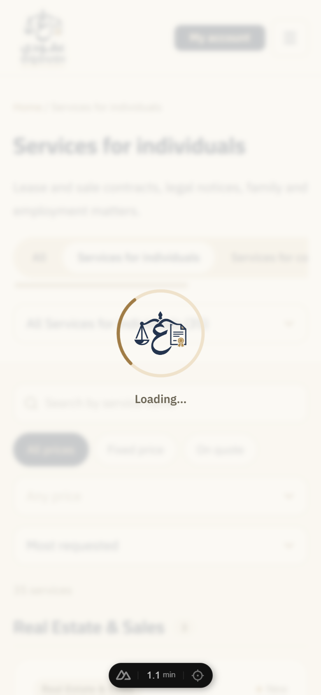

# Logo loading indicator

One branded loader (the OQOUDI mark inside a rotating gold ring) shown for **page navigation** and **endpoint calls**.
Added 2026-10-17.

| File | Role |
|---|---|
| `app/components/ui/UiLogoSpinner.vue` | The spinner itself. `size` = `sm` / `md` / `lg` or pixels; `decorative` hides it from assistive tech. Usable anywhere (e.g. an in-panel placeholder). |
| `app/components/layout/GlobalLoading.vue` | App-wide overlay/pill, mounted once in `app.vue`. |
| `app/composables/useGlobalLoading.ts` | Client-only state. `begin(kind)` → `end()`, `track(kind, task)` for non-fetch work. |
| `app/plugins/loading.client.ts` | Feeds the state from Nuxt's page-loading hooks and a wrapped `window.fetch`. |
| `shared/domain/loading.ts` | Pure logic: request classification and the show/hide timing (unit-tested). |
| `public/brand/oqoudi-mark.png` | The mark cropped from `oqoudi-logo-tight.png` (413×352, transparent). |

## What drives it

- **Routing** — `page:loading:start` / `page:loading:end` (the hooks `<NuxtLoadingIndicator>` uses).
- **Endpoint calls** — `fetch` is wrapped once. `$fetch`/`useFetch` (ofetch resolves the global per call) and every Supabase REST/auth/storage call (supabase-js and `@nuxtjs/supabase`'s retry wrapper do too) go through it, in any plugin order.

| Call | Treated as | Shows |
|---|---|---|
| Page navigation | `route` | overlay, **click-through** (a slow navigation can always be abandoned) |
| `/api/**` POST/PUT/PATCH/DELETE, Supabase REST writes, auth sign-in/out | `mutation` | overlay, **blocks clicks** while pending |
| `/api/**` GET, Supabase GET, PostgREST `rpc/*` (POST but read-only here), storage transfers | `read` | small bottom-centre pill, never covers the page |
| Supabase `HEAD` (badge counters), automatic token refresh, any request with `x-oq-silent` | ignored | nothing |

Storage transfers are `read` on purpose: uploads render their own progress and must not sit under a veil.
Opt a same-origin background call out with `headers: { 'x-oq-silent': '1' }` (the launch-campaign ticker does). Never send that header to Supabase: its CORS allow-list would reject the preflight.

## Timing (constants in `shared/domain/loading.ts`)

- Shown only after **250 ms** — fast navigations and calls never flash a loader.
- Once shown, stays **≥ 450 ms** — no blinking when work ends just after the delay.
- **150 ms** hide grace — sequential calls (upload = sign → PUT → complete) don't flicker between steps.
- **30 s** failsafe per item — a hung request or a lost hook can't trap the user.

## Accessibility

A persistent `role="status"` live region announces "جارٍ التحميل…" / "Loading…"; the visual layer is `aria-hidden`. With `prefers-reduced-motion` the ring stops and the mark only fades slowly. RTL/LTR use logical properties.

## Evidence (2026-10-17, local Supabase stack, dev server)

**Implemented and verified**
- Unit `tests/unit/loading.test.ts` — 15 tests (classification rules, delay, minimum time, grace/bridging, failsafe, reset); whole unit suite 112/112.
- E2E `tests/e2e/loading.spec.ts` — slow navigation shows the loader and doesn't block clicks; a pending sign-in write shows it with `data-blocking="true"`; both clear afterwards. `catalog.spec.ts` + `contract-order.spec.ts` (19 tests, full order/payment journeys through the overlay, hydration/console-error check) still pass.
- Browser timeline under Slow 3G (sampled every 40–50 ms): nothing for 250 ms → overlay with `blocking` while the write is pending → `blocking` drops the instant it ends → fade → removed. Fast cached navigations showed nothing in 4/4 runs. Through the **real** `$fetch` and Supabase client: write → overlay+blocking; GET → pill; `rpc` → pill; `HEAD` → nothing; `x-oq-silent` → nothing.
- `nuxt typecheck` exit 0; ESLint clean on every changed file.

**Not verified:** Firefox/Safari; a production build/Vercel deploy; keyboard focus behind a blocking veil (the veil blocks the pointer only; focus stays reachable, bounded by the 30 s failsafe); a screen reader actually announcing the status text.

## Related fix: wrong badge on shared services

A service linked to several top-level categories has one *primary* category. The directory used to badge every card with it, so «صياغة عقد» showed "خدمات الشركات" on the Individuals page. Inside a top-level category, anything that isn't one of its contracts is now badged with the category being browsed (`cardLabel` in `ServicesDirectory.vue`). Regression test: `catalog.spec.ts` › "badged with the one being browsed" (fails on the previous code with `Received: "خدمات الشركات"`).
